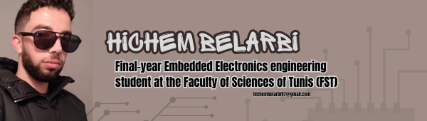

<!-- Header Banner -->

  

---

##  Technologies & Platforms

### Programming & Development

### Embedded & IoT Systems

`FreeRTOS` · `GPIO/PWM` · `UART` · `I2C` · `SPI` · `DMA` · `DAC` · `Timers`

### Hardware Design & Simulation

`Proteus` · `PCB Design` · `Oscilloscope` · `Signal Generator`

### IDEs & Tools

`IAR Embedded Workbench` · `MATLAB/Simulink`

### AI & Computer Vision

`YOLO` · `NCNN` · `FastPlate OCR` · `Model fine-tuning` · `Edge deployment`

### Web & Databases

---

##  Internships

### SKIDATA, Tunis 

**Embedded Vision & Web Development Intern** | *Aug 2025 - Sep 2025*
- Built a license plate recognition pipeline on Raspberry Pi, combining a custom-trained YOLO detector and FastPlateOCR (about 86% validation accuracy).
- Fine-tuned the OCR model on Tunisian license plate datasets using Google Colab.
- Delivered the full system as **PARKit**, including the reservation web app, the server API and the sensor-driven barrier (see Projects below).

### SKIDATA, Tunis 

**Embedded Systems & IoT Intern** | *Jul 2025 - Aug 2025*
- Developed an automated 24/7 standalone display system on Raspberry Pi 4, running in kiosk mode, for real-time parking spot availability.
- Designed a web administration interface to configure content remotely across devices on the local network.

---

##  Featured Flagship Project

### 🚗 **PARKit: Parking Access by License Plate Recognition**

End-to-end parking system: online reservation, license plate reading on a Raspberry Pi 4 (YOLO + OCR fine-tuned on Tunisian plates), reservation check through a secured server API, and automatic barrier opening driven by two IR sensors and a servo over GPIO. About 0.3 s of CPU-only inference per plate. Fail-safe by design: access is denied on any server or network error, and the barrier never closes on a vehicle.

`Raspberry Pi 4` · `Python` · `YOLO (NCNN)` · `FastPlate OCR` · `OpenCV` · `GPIO` · `PHP` · `MySQL`

---

##  Academic Projects

| Project | Year | Stack | Description | Link |
| :--- | :--- | :--- | :--- | :--- |
| **Harvix: Intelligent Data Datalogger & Rule Engine** | 3rd year | STM32, FreeRTOS, PyQt5, Fusion 360 | Real-time programmable system handling multi-protocol sensor inputs and rule-based action triggers, with a PyQt5 desktop app (Harvix Studio) and a custom 3D enclosure. Prototype presented to an industry jury at Actia. |  |
| **Component Counter Station** | 3rd year | ESP32, YOLOv8, PyQt5, PHP/MySQL | Automated electronic component counter using YOLOv8 vision detection on ESP32, with a multi-station packaging and inventory dashboard. |  |
| **STM32 Signal Generator** | 3rd year | STM32, DMA, DAC, TIM6, USB CDC | Hardware signal generator where the TIM6 timer triggers DMA transfers directly to the DAC outputs. |  |
| **STM32H5 Instruction Cache (ICACHE) Analysis** | 2nd year | C, Embedded Architecture | Group study of the STM32H5 instruction cache, with low-level driver functions and cache-miss benchmarks under varying configurations. | — |
| **Battery Level Indicator PCB** | 1st year | Hardware Design, Comparators | Schematic and custom PCB using voltage comparators for battery status detection. | — |

---

##  Education

| Period | Program | Institution |
| :--- | :--- | :--- |
| **2024 - present** | Engineering Degree in Embedded Electronics | Faculty of Sciences of Tunis (FST) |
| **2022 - 2024** | Preparatory Cycle in Mathematics, Physics and Computer Science (MPI) | Faculty of Sciences of Tunis (FST) |

---

##  Achievements & Community

- 🥉 **3rd Place**, InnoSpeed Hackathon
- 🤖 **Participant**, RoboGenesis Hackathon
- ⚡ **Member**, IEEE Student Branch

---

##  Languages

**Arabic** (Native) | **French** (Fluent) | **English** (Professional Working Proficiency)

---

<!-- Footer Banner -->

  

